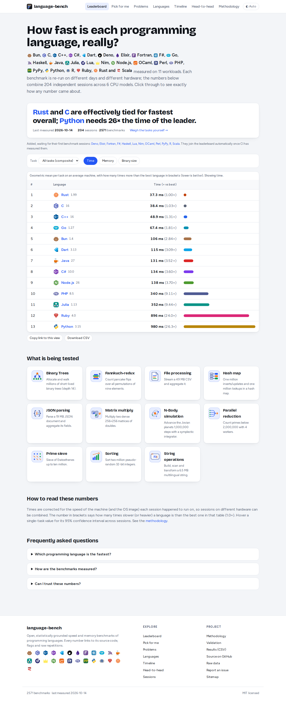

# language-bench



_Screenshot of the live site, refreshed automatically after every deploy by `.github/workflows/screenshot.yml`._

Transparent speed and memory benchmarks of **C, Rust, Go, Node.js and CPython** on nine workloads
(N-body, binary trees, JSON parsing, hash map, sorting, string operations, parallel reduction, file
processing, start-up). Results are measured on GitHub Actions, repeated on different days and hardware,
combined with documented statistics, and published as a static site.

## How it works

- **Benchmark** = language version + build setting (compiler flags, runtime options) + problem.
- **Session** = one CI job on one fresh VM running *many* benchmarks (all languages) in randomised order, each with hyperfine repetitions. The planner picks the least-measured benchmarks and re-runs some already measured ones; those overlaps let the statistics separate machine speed from benchmark speed (`log time = benchmark + machine`).
- **Data** is append-only: `data/sessions.json` (full environment of every session) and `data/<language>.json` (every measurement incl. the verbatim hyperfine export); nothing derived is stored.
- **Statistics** (`core/src/stats.ts`): sessions are the independent samples; machine factors fitted from overlapping benchmarks; geometric mean over sessions; cluster-bootstrap 95% CIs.
- **Automation**: `bench.yml` discovers new language releases, plans sessions from `lb.config.json` (target sessions per benchmark, session size, overlap, ...), runs them, commits the data and re-triggers itself until all tracked benchmarks have enough data.
- **Site** (`web/`, Next.js static export) computes everything from the raw data at build time; every number links to its sessions, source, flags and CI run.

## Layout

| Path | Purpose |
| --- | --- |
| `languages/<id>/` | one folder per language: `language.json` (versions, build variants), `releases.json`, `impl/<problem>/` sources |
| `problems/<id>/` | `problem.json`, optional `generate.mjs`, `expected.txt` |
| `data/` | measurements (written by CI only) |
| `runner/` | CLI: verify, bench, merge, matrix |
| `core/` | schemas, discovery, statistics (tested) |
| `web/` | website |

Add a language by adding a `languages/<id>/` folder; add a problem by adding a `problems/<id>/` folder. Nothing else needs registering.

## Commands

```bash
pnpm install
pnpm test                                   # statistics tests
pnpm lb verify python --version 3.14        # build + check outputs in Docker
pnpm lb plan                                # what would run next (writes .work/plans)
pnpm lb session --plan .work/plans/session-1.json --out .work/frag/s1.json --reps 3   # run a session locally (needs Docker)
pnpm build                                  # static site -> web/out
```

CI: `verify.yml` (changed implementations must print `expected.txt`), `bench.yml` (self-continuing sessions, appends data), `deploy.yml` (GitHub Pages).
Read the [methodology](web/app/methodology/page.tsx) for details and limits.
